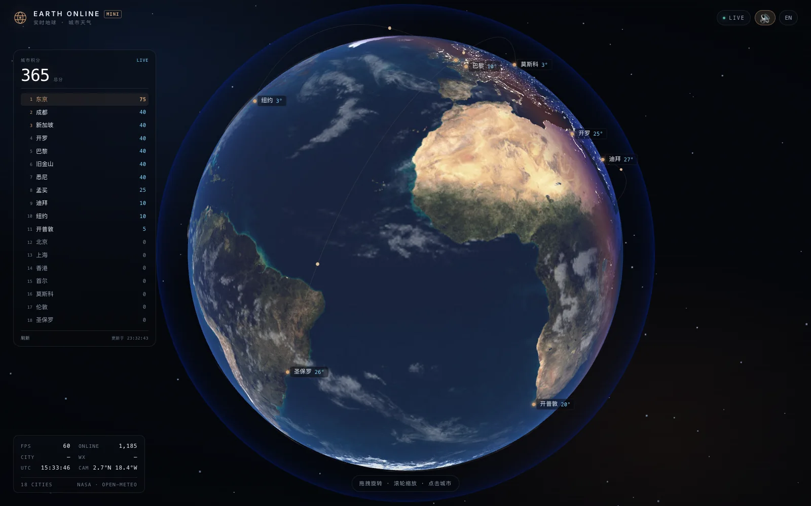
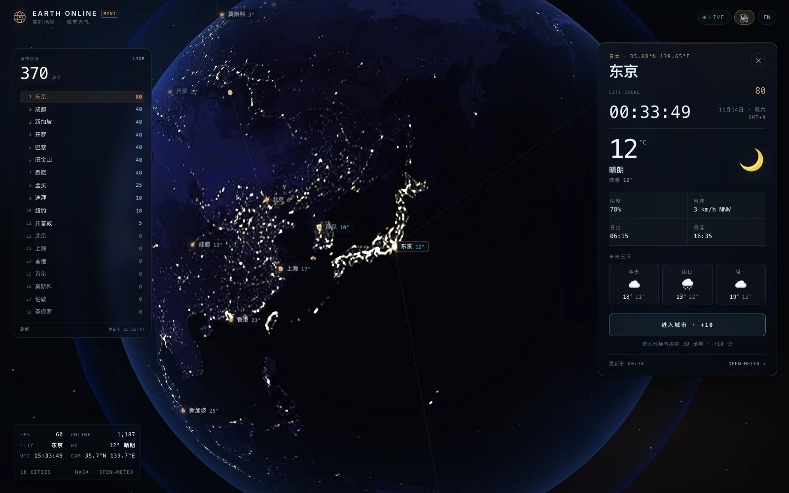
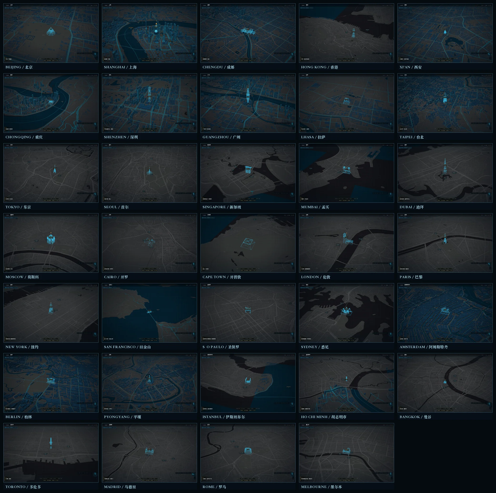
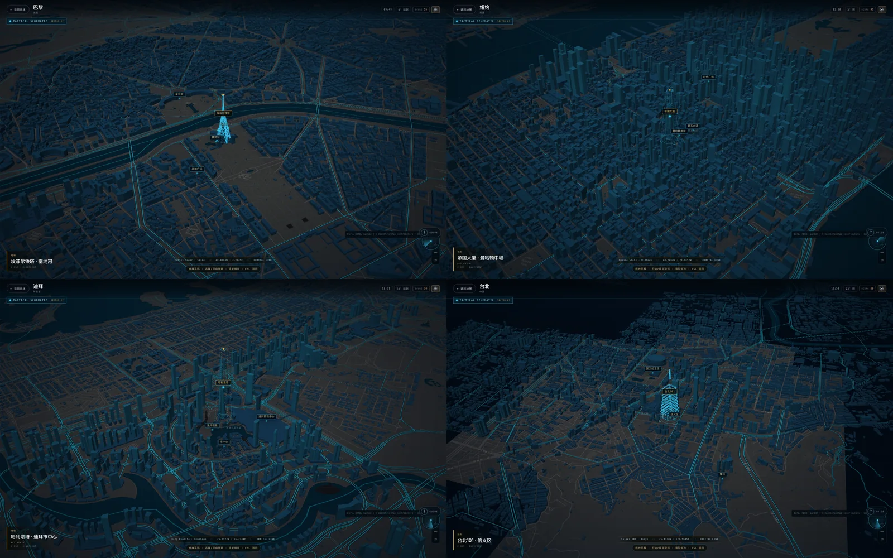
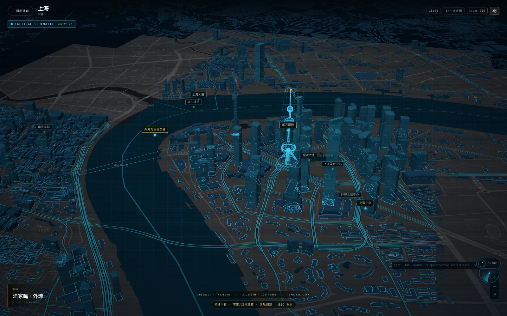
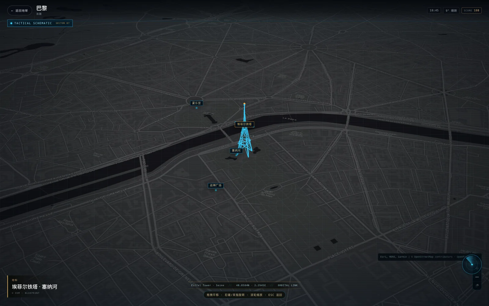
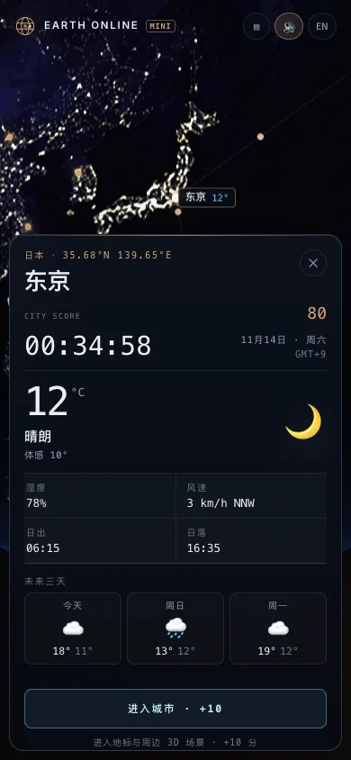
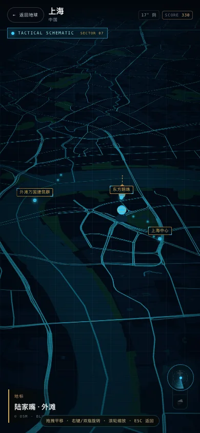

# Earth Online · mini

A real-time, shareable Earth for [elevenbeans.me](https://elevenbeans.me) — NASA globe, live weather, a shared city score board, and a MapLibre/OSM **Orbital Blueprint** 3D city view for **all 34 cities**.

> Homepage project: https://elevenbeans.me/earth-online/. Self-contained under `earth-online/`. No build step and no framework. The shared score API lives on the NAS in `nas/nas-portal`; this README is also the `earth-online` project doc read by the NAS profile-chat assistant.



## What you can do

- **Focus a city — +5.** Click or tap a marker dot **or its label**. The camera flies in, the weather panel opens, and the shared city score increments.
- **Enter the city — +10.** The panel's **进入城市 · +10** button opens a full-screen Orbital Blueprint map of the city's signature district, with OSM building footprints/heights, a blueprint landmark layer, and local labels. Repeatable: come back and enter again for another +10.
- **Shared city score.** The left board lists all 34 cities, highest first, with the total shared across every visitor. On mobile the same board opens from the **▤** button in the top bar.
- **First-visit continent intro.** The globe infers the visitor's continent from the browser timezone (no location permission prompt), centers on it, and shows a small continent chip. A `?city=` deep link skips the intro.
- **No economy.** There are no credits, contracts, levels, combos, ranks, stability or demolition/rebuild. The visit itself is the score.
- **Technical game guide.** A bottom-right **? / GUIDE** entry opens a complete, bilingual feature list; each feature includes a one-line implementation note capped at 20 characters.

## Scores and anti-abuse

| Action | Points |
| --- | --- |
| Focus a city (marker click) | +5 |
| Enter the 3D city detail | +10 |

- Scores are **global**, not per user; all visitors share the same counters. The board is sorted descending and always shows all 34 cities. Clicking a board row is a navigation shortcut: it focuses the city and opens the panel, but does **not** add points; only globe marker focus (+5) and entering the city (+10) score.
- The client updates optimistically, sends a session-token event immediately, and queues failed events in `localStorage` for retry. The board shows `SYNCING`, `离线 · N`, or `LIVE`.
- The NAS issues short-lived session tokens and applies a small per-token/city/action cooldown (0.8 s focus, 1.5 s detail) plus an IP rate limit. Very rapid repeats may show **操作太快 · 本次未计分**.
- Events carry an idempotency `eventId`, so a retry after a lost response does not double-count.
- The score file is persisted at `nas-portal/.data/earth-online-scores.json` (override with `EARTH_SCORE_FILE`).

## All cities — Orbital Blueprint

Every city now opens the same MapLibre/OSM city view instead of a procedural diorama:

- **MapLibre GL JS** renders a pitched, rotated map of the signature district.
- **OpenFreeMap / OpenStreetMap** supplies building footprints and `render_height` values, extruded in 3D.
- **Esri World Dark Gray Base** is used as a no-key raster fallback so a city is still readable when vector tiles are slow or unavailable.
- **Orbital Blueprint palette:** deep navy land and water, cyan building outlines and roads, cyan grid/scanlines and radar, with amber selected labels and the city score. A `TACTICAL SCHEMATIC` HUD sits over the map. No satellite layer is used.
- Each city has a **blueprint landmark layer** drawn in a Three.js custom layer. Where the OSM massing already reads as the landmark (Empire State, Burj Khalifa, CN Tower, Ryugyong Hotel, Gateway of India), the map model is the landmark and a real-height **lock-on frame** adds a ground survey ring, tapered guide volume, altitude ruler and amber beacon. Everywhere else a **structural edge wireframe** carries the silhouette that a single-height extrusion cannot: Oriental Pearl, Taipei 101, Temple of Heaven, Anshun Bridge, Bank of China, the Giant Wild Goose Pagoda, Hongya Cave, Ping An Finance, Canton Tower, Potala Palace, Tokyo Tower, N Seoul Tower, Marina Bay Sands, St. Basil's, the Giza pyramids, Table Mountain, Big Ben, the Eiffel Tower, the Golden Gate Bridge, MASP, the Sydney Opera House, Amsterdam canal houses, the Brandenburg Gate, Hagia Sophia, Bitexco Tower, Wat Arun, the Royal Palace of Madrid, the Colosseum, and Flinders Street Station.
- The Eiffel Tower's OSM footprint is excluded from the building extrusion because a 48×48 m footprint swept to 330 m reads as a skyscraper; the structural lattice is the only Eiffel on the map.
- **No API key** is required at runtime; internet access is required for the raster/vector tiles.

## 3D city detail

The city view is the real-map district described above, with a blueprint landmark layer and pinned labels. If MapLibre fails, the old procedural Three.js landmark/district is used as a fallback. The globe and weather panel still show the city's local time and current conditions.

| City | Landmark |
| --- | --- |
| Paris | Eiffel Tower lattice |
| Tokyo | Tokyo Tower |
| New York | Empire State |
| London | Big Ben & Parliament |
| Beijing | Temple of Heaven |
| Shanghai | Lujiazui + Bund |
| Hong Kong | Bank of China Tower |
| Singapore | Marina Bay Sands |
| Sydney | Opera House sails |
| Amsterdam | Canal houses |
| Berlin | Brandenburg Gate |
| Pyongyang | Ryugyong Hotel |
| Istanbul | Hagia Sophia |
| Ho Chi Minh | Bitexco Tower |
| Bangkok | Wat Arun |
| Toronto | CN Tower |
| Madrid | Royal Palace |
| Rome | Colosseum |
| Melbourne | Flinders Street Station |
| Dubai | Burj Khalifa |
| Moscow | St. Basil's onion domes |
| Cairo | Giza pyramids & sphinx |
| Cape Town | Table Mountain |
| São Paulo | MASP |
| San Francisco | Golden Gate Bridge |
| Seoul | N Seoul Tower |
| Mumbai | Gateway of India |
| Chengdu | Anshun covered bridge |
| Xi'an | Giant Wild Goose Pagoda |
| Chongqing | Hongya Cave |
| Shenzhen | Ping An Finance Centre |
| Guangzhou | Canton Tower |
| Lhasa | Potala Palace |
| Taipei | Taipei 101 |

Drag to pan, scroll or pinch to zoom, right-drag or two fingers rotate/pitch the map. `Esc` or **返回地球** leaves. The globe camera and open panel are preserved when you return.

## Screenshots

| Shared score board + globe | City weather panel |
| --- | --- |
|  |  |

| All 34 cities — Orbital Blueprint | |
| --- | --- |
|  | |

| Blueprint landmark layer — lattice vs OSM lock-on | |
| --- | --- |
|  | |

| Shanghai | Paris |
| --- | --- |
|  |  |

| Mobile weather sheet | Mobile 3D Shanghai |
| --- | --- |
|  |  |

## Run it

The page needs an HTTP origin because it uses ES modules and local textures:

```bash
cd myprofile
python3 -m http.server 8137
# open http://localhost:8137/earth-online/
```

Local pages use the NAS score server at `http://localhost:3000/api/earth-score`. Start it from the NAS project:

```bash
cd ../nas/nas-portal
npm install
npm run build && npm start
```

If you prefer the NAS dev server (`npm run dev`, port 3001), open the game with an override:

```text
http://localhost:8137/earth-online/?api=http://localhost:3001/api/earth-score
```

Production pages use `https://nas.elevenbeans.me/api/earth-score`. Deploy the NAS with:

```bash
cd ../nas/nas-portal
npm run sync
```

The page itself is static; publish `myprofile/earth-online/` as usual.

## Background music

The home page uses an original slow piano piece in A minor: broken chords, a low root, a soft string pad and a long dark echo. It is generated live with Web Audio and uses no samples or copyrighted melody.

- It is the **only** background track: it keeps playing when the user opens or leaves a city. There are no per-city themes.
- In WeChat's WebView the piano is high-passed at 72 Hz, sub-bass notes are raised or trimmed, and the compressor is bypassed. This avoids the low-frequency hum some WeChat/iOS audio paths add to Web Audio. Use `?audio-debug=1` for a small readout of mode, context state, sample rate and active track.
- The **♪** button in the city header (and the globe top bar) mutes/unmutes the piano and UI effects globally.

## Controls

| Action | Input |
| --- | --- |
| Focus a city (+5) | Click / tap a marker dot or label |
| Enter the 3D city (+10) | **进入城市 · +10** in the weather panel |
| Orbit / pan | Drag / one finger |
| Rotate / pitch (Shanghai map) | Right-drag / two fingers |
| Zoom | Wheel / pinch |
| Back to the globe | **返回地球**, `Esc`, or the panel close button |
| City score board | Left board on desktop; **▤** in the top bar on mobile. Rows are clickable and open that city's panel. |
| Language | **EN / 中文** |
| Sound | Speaker button (on by default; unlocks on the first gesture) |
| Game guide | **? / GUIDE** at the bottom-right; scrollable technical feature list |
| Keyboard orbit | Arrow keys while the globe is focused |

## URL flags

- `?city=paris` — focus a city on load (does not award points)
- `?lang=en` — force a language for this visit
- `?proc=1` — skip textures and render the procedural night-lights globe
- `?shot=1` — screenshot mode: no intro zoom, no auto-rotation
- `?api=https://…/api/earth-score` — override the score endpoint (useful for local NAS development)

## How it works

- `index.html` contains all markup, styles and application JavaScript.
- `vendor/three.module.min.js` is Three.js r160 (MIT), loaded locally with a CDN fallback.
- `vendor/maplibre-gl.js` + CSS are MapLibre GL JS 4.7 (BSD-3), loaded locally for every city view.
- Each city's 3D layer is a MapLibre `fill-extrusion` of the `building` source-layer from OpenFreeMap, combined with water/road layers, an Esri dark-gray raster fallback, a blueprint HUD overlay and HTML landmark labels. No building data file is bundled; tiles are fetched at runtime.
- Each landmark is a separate Three.js custom layer on the MapLibre canvas. The five OSM-readable landmarks get a lock-on frame tied to the map's `building:part` massing and a real `ALT` readout; the rest get structural edges (`EdgesGeometry`, not a triangulated wireframe) over a dim volume, scaled to the city's visual landmark height. Both use a ground survey ring and an amber beacon; Shanghai keeps its bespoke Oriental Pearl geometry in the same edge language.
- `textures/` holds NASA day, night-lights and cloud maps (public domain, via the Three.js examples).
- The globe uses a custom shader to blend day/night maps at the real subsolar point, with a warm terminator band, atmospheric rim, stars, clouds and great-circle arcs.
- City markers are HTML buttons projected from 3D positions each frame, so they stay crisp and keyboard accessible.
- Weather comes from [Open-Meteo](https://open-meteo.com/) with a 10-minute `sessionStorage` cache; the panel shows local clock, current conditions, feels-like, humidity, wind, sunrise/sunset and a three-day forecast.
- Air quality is a separate Open-Meteo Air Quality request (`us_aqi`, `pm2_5`, `pm10`) with the same 10-minute cache and independent failure state; the panel shows US AQI, its category, and PM2.5.
- The 3D detail scene is built from `BoxGeometry`, `CylinderGeometry`, `ConeGeometry`, `SphereGeometry`, `ExtrudeGeometry` and `Line` primitives; no external models. A seeded PRNG keeps each district deterministic.
- Web Audio synthesises the UI cues and the home piano piece, which also plays in every city view. The first pointer/key creates/resumes the AudioContext; opening or leaving a city does not change the soundtrack. The **♪** button in the city header or top bar mutes/unmutes everything; no audio files are loaded.
- The score API is implemented in `nas-portal/app/api/earth-score/route.ts` and `session/route.ts`, with shared state in `lib/earth-score.ts`.

## Known limitations

- All city maps are stylised Orbital Blueprint views, not photo-real. Non-supertall landmarks are deliberately exaggerated where the real structure is low so they read at map scale; the five lock-on cities use the real OSM massing and altitude. Photo-real Google/Amap/Baidu detail would require their platform keys and 3D tiles.
- OSM building coverage and OpenFreeMap tile availability vary by city. The Esri dark-gray raster base keeps the district readable when 3D building tiles are missing; a city may temporarily show a 2D base plus the blueprint landmark.
- The view needs network access for raster/vector tiles. If MapLibre fails entirely, the procedural Three.js district is used as a fallback.
- Shared scores require the NAS API. Without it the board shows offline, keeps optimistic points, and retries queued events when the connection returns.
- Weather is current conditions at roughly 15-minute resolution; if Open-Meteo is unavailable the panel shows a retry state and the 3D scene falls back to the city's local day/night.
- Air quality is model-based (CAMS via Open-Meteo), not a local monitoring station; the panel shows US AQI, and values can differ from official city readings.
- The "online" count is simulated.
- Very rapid repeated clicks can be dropped by the score cooldown; this is intentional anti-abuse behaviour.
- Audio defaults on, but browsers require one user gesture before sound can play; the first click/key starts the home piano, which continues through city views. The **♪** button mutes/unmutes everything, and the preference is remembered. The soundtrack is original Web Audio synthesis; no copyrighted melody or recording is used.

## Credits

- Three.js — MIT, see `vendor/LICENSE`.
- MapLibre GL JS — BSD-3, see `vendor/maplibre-gl.LICENSE`.
- City building footprints/heights — © OpenStreetMap contributors, rendered via [OpenFreeMap](https://openfreemap.org/).
- Dark-gray raster fallback — Esri, HERE, Garmin, © OpenStreetMap contributors.
- Earth imagery — NASA Blue Marble / Black Marble / cloud maps, public domain, via the Three.js example assets.
- Weather & air quality — [Open-Meteo](https://open-meteo.com/), free for non-commercial use, no key required.
- Score API — Next.js route handlers in `nas-portal`, with file-backed persistence and in-memory session/rate-limit state.
